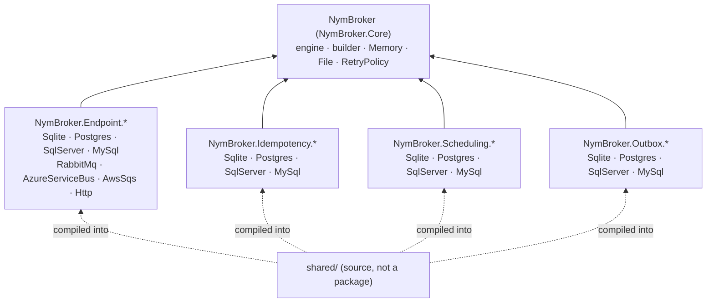
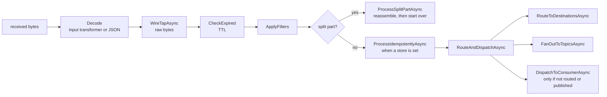

# Architecture

How NymBroker is built, for people working on the code itself. If you use the packages, start with the [user guide](user-guide.md); if you are adding a transport, also read [Writing an endpoint](writing-an-endpoint.md).

## Packages

Every package is a project of the same name, and its namespace is the package ID. Only Core is required; everything else plugs into it.

| Part | Role |
|---|---|
| `NymBroker.Core` | The broker engine (`NymBrokerImpl`, internal), the public `INymBroker` runtime API, `NymBrokerBuilder` (all configuration), serializer and envelope, routing, topics, consumers, idempotent receiver, scheduling, splitter and aggregator, health checks, the Memory and File endpoints, `RetryPolicy`, and the building blocks endpoint packages derive from. No transport dependency. |
| `NymBroker.Endpoint.*` | One transport each. Queue-table endpoints (SQLite, PostgreSQL, SQL Server, MySQL) use a nested listener derived from Core's `LeasedQueueListener`; broker transports (RabbitMQ, Service Bus, SQS) push or poll natively; HTTP is send-only. |
| `NymBroker.Idempotency.*`, `NymBroker.Scheduling.*`, `NymBroker.Outbox.*` | Durable stores behind Core's `IExpiringIdempotencyStore` (and `ITransactionalIdempotencyStore`), `IScheduleStore` and `IOutboxStore`, independent of the endpoint packages. Core's hosted `OutboxDispatcher` sends what the outbox stores hold. |
| [`shared/`](../shared/README.md) | Internal source compiled into several packages through `Directory.Build.targets`: identifier quoting per database, the store plumbing, and queue inspection. Shares code without a shared package or public API. |
| `NymBroker.Tests` | One xUnit project: unit tests always run; integration tests run when their `NYMBROKER_*` variable is set (`scripts/test-all.ps1` sets all of them). |
| `samples/` | Runnable apps, including the [benchmark](benchmarks.md). |

All packages share one `<Version>` in `Directory.Build.props` ([Versioning](versioning-and-api-compatibility.md)).

## Configuration and start-up

Configuration is **builder-only**. `NymBrokerBuilder` collects endpoints, consumers, routes, topics, transformers, filters, scheduled actions and policies, in code or from `queuesettings.json`. `Build()` validates what it can, registers the core services, and snapshots the builder's state into a private `BrokerBlueprint`; the DI factory replays that blueprint onto a new `NymBrokerImpl` in a fixed order.

`StartAsync` (under the lifecycle lock) logs the endpoints, runs `ValidateConfiguration` — every route, topic, dead-letter and wire-tap target must exist and be writable, and an output-transformed endpoint must not be read back without an input transformer — then starts scheduled actions and one listener per event-driven endpoint that is not `WriteOnly` (`StartListenersAsync`). A failure rolls back what started and rethrows.

## Processing a message

Every listener hands received bytes to `ProcessAsync`, which never throws (except for the broker's own cancellation) and returns a `ProcessResult` telling the transport how to settle the message. The pipeline is one method per stage, in `NymBrokerImpl.Processing.cs`; forwarding to routes and topics is in `NymBrokerImpl.Forwarding.cs`, dead-lettering in `NymBrokerImpl.DeadLetter.cs`, and the send path in `NymBrokerImpl.Sending.cs`:

`ProcessAsync` decodes the bytes before it starts the `nymbroker.process` activity, so the activity can continue the W3C trace context the envelope carries ([Observability](observability.md#trace-context-across-messages)). The wire tap then receives the original bytes before the decode result or a captured transformer failure is acted on. Instrumented sends start `nymbroker.send` activities (`NymBrokerImpl.Tracing.cs`).

Which result each situation gets depends on whether the source endpoint dead-letters natively (the SQL tables, RabbitMQ and Service Bus do; Memory, File and SQS don't). The full table is in [Writing an endpoint](writing-an-endpoint.md#native-dead-lettering-usesnativedeadletter). For consumer and topic failures it is one rule in code: `SettlementFor` picks a `FailureSettlement` and `SettleFailureAsync` applies it. Every send — post, route, topic, wire tap, dead letter — goes through `SendAsync` / `SendBatchAsync`, so output transformers are never bypassed.

## Endpoint building blocks

- `EndpointHandler.InvokeAsync` calls the broker's handler for an endpoint and turns an unexpected exception into `Retry`.
- `LeasedQueueListener` owns the loop for lease-based queues: claim a batch, process, map `ProcessResult` to a queue status, write outcomes and claim the next batch in one transaction, promote due deferred messages, and run retention clean-up beside the loop.
- `AsyncOnce` runs schema creation once, retrying after a failure.
- `IQueueInspector` (counts and paged listings by state) is implemented by the queue-table endpoints on top of `shared/Inspection`; only the SQL and parameter binding differ per database.

## Design rules

The rules that shape new code — no silent catch blocks, the dependencies we do not take (Autofac, Newtonsoft, Polly, Dapper, Cronos in packages), package naming, how receiving endpoints settle, public API tracked by the PublicAPI analyzers — are listed in the repository's root `CLAUDE.md` under *Key design rules*, with the per-project details in each project's `CLAUDE.md`.

## Quality gates

The checklist for a change is in [CONTRIBUTING.md](../CONTRIBUTING.md#development). CI (`.github/workflows/ci.yml`) enforces the automatic part on every push and pull request: the build with warnings as errors — including `latest-recommended` analyzers, code style and the PublicAPI analyzers ([Versioning and API compatibility](versioning-and-api-compatibility.md)) on the packages — and `dotnet test` with the code-health gate below. Integration tests (`./scripts/test-all.ps1`) and the [benchmark](benchmarks.md) need local Docker services and are run by hand.

## Code health

`NymBroker.Tests/CodeHealth/CodeHealthTests.cs` measures the production code — Core, the endpoint, idempotency, scheduling and outbox packages, and `shared/` — from the syntax tree (Roslyn, no compilation) and fails when something is over a limit. Tests and samples are measured but not gated. The targets come from [#112](https://github.com/nymankla/NymBroker/issues/112).

| Metric | What it counts | Good | Acceptable | Limit |
|---|---|---|---|---|
| Method lines | The declaration, signature to closing brace | 1–15 | 16–30 | 50 |
| Cyclomatic complexity | 1 + each `if`, loop, `case`, switch arm, `catch`, `?:`, `&&`, `\|\|`, `??`, `?.` | 1–5 | 6–10 | 10 |
| Cognitive complexity | Sonar-style: each branch or loop costs 1 plus its nesting depth; `else` and each run of `&&` / `\|\|` cost 1 | 1–5 | 6–15 | 15 |
| Nesting | Deepest control-flow nesting; the method body is level 0, so an `if` in a loop is 2 | 1 | 2 | 3 |
| Parameters | Declared parameters | 0–3 | 4 | 5 |
| Type size | Lines of one type declaration; each file of a partial class counts on its own | < 200 | 200–500 | 500 |
| Duplication | Production code lines inside a 10-line block that also appears elsewhere | 0 % | < 3 % | 3 % |

Above "acceptable" is the warning band: refactor. Ways out, in the order to try them: guard clauses and early returns for nesting; extract a well-named method for length and complexity; a small record (parameter object) for parameters that travel together; a partial-class file per concern, or a new type, for size; `shared/` or a base class for duplication.

Not gated on parameters: constructors (the DI container fills them) and public API whose signature can't change without a breaking release (`EndpointHandler.InvokeAsync`, `HealthCheckResult.FromProbeAsync`, `INymBroker.PostBatchAsync`; the list is `ParameterExceptions` in the test).

**The limits are a ratchet.** If a change pushes something over a limit, split it; never raise the limit. When the worst value drops, lower the limit towards the top of the acceptable band. In the November 2026 measurement every limit held; the worst values were 47 lines, cyclomatic 10, cognitive 14, nesting 3, and a 431-line type, with 0.80 % duplication. Re-run the report below for current values.

Running it:

- It runs with every `dotnet test`. To run it alone: `dotnet test --project NymBroker.Tests -- --filter-class "*CodeHealthTests"`.
- In CI it appends a summary to the job summary: for each metric, how many methods are good, acceptable or in the warning band, the worst one, and the limit; then the ten most complex methods.
- For a full report, set `NYMBROKER_CODE_HEALTH_REPORT` to a file path; the test writes every method, type, file and duplicated block as JSON. The `code-health` agent skill (`.claude/skills/code-health`) does this, summarizes it and ranks refactoring candidates.
