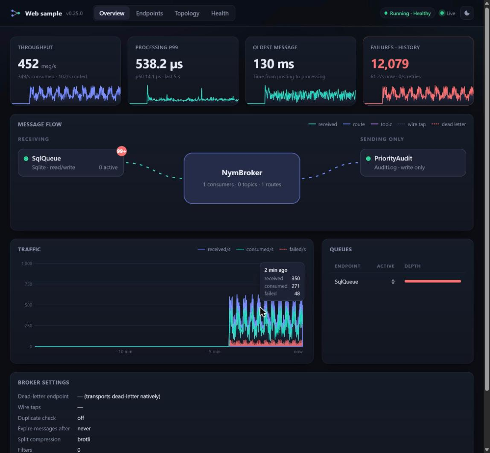
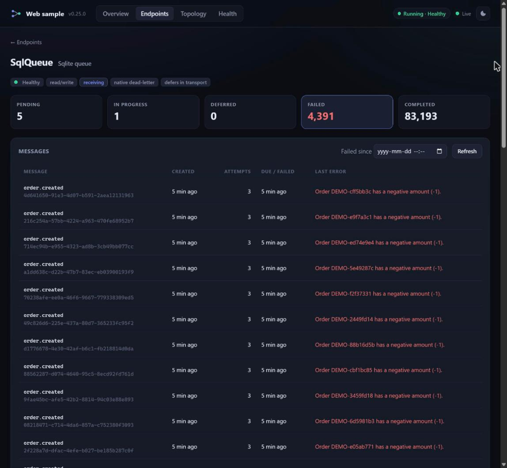
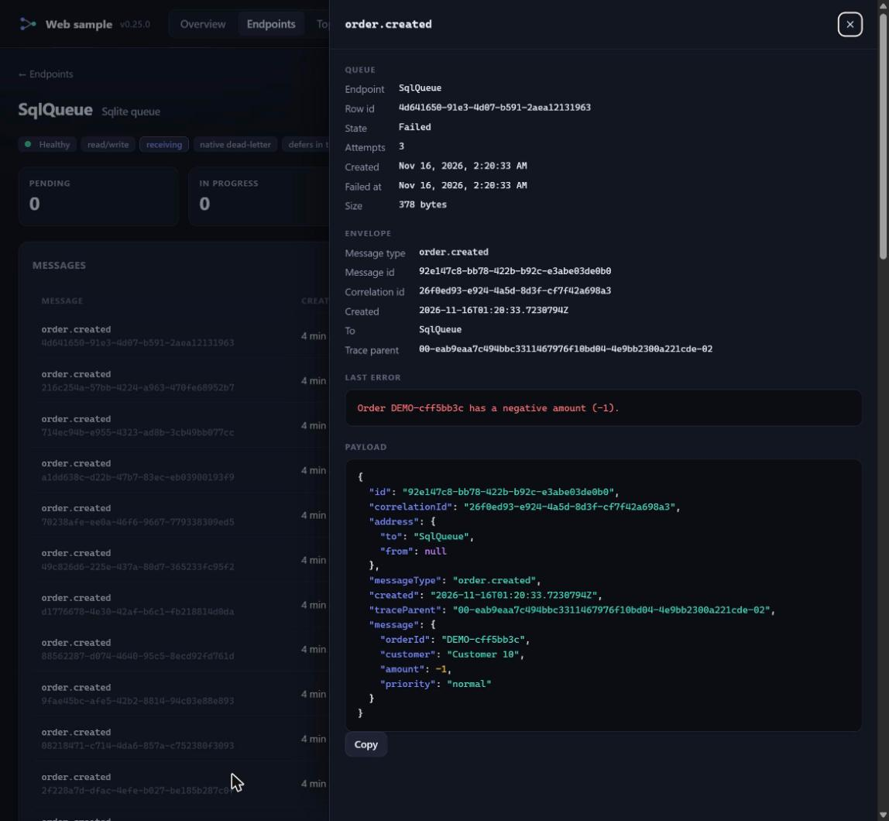
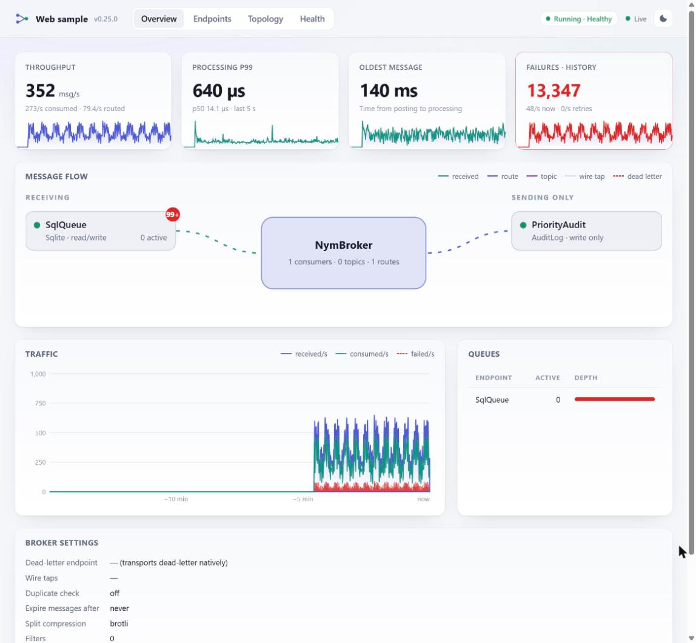
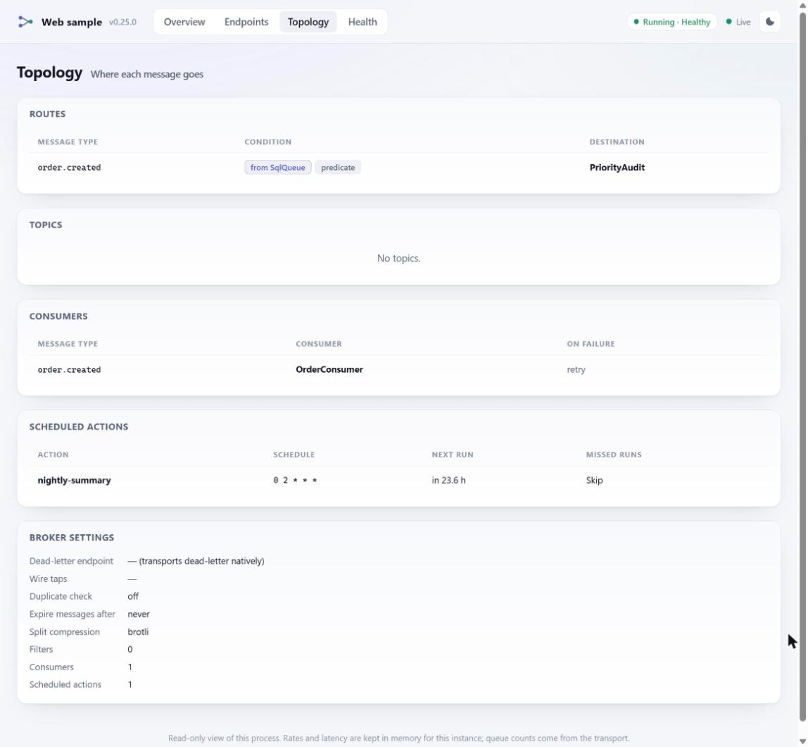

# Dashboard

[← User guide](user-guide.md)

`NymBroker.Dashboard` is a live web page for a running broker, served from your own ASP.NET Core app. It shows how messages flow between your endpoints, what is waiting or failed in each queue, the health of every endpoint, and the broker's throughput and latency over the last 15 minutes. It needs no database, collector or other service: it reads the broker in the process it runs in.



```bash
dotnet add package NymBroker.Dashboard
```

```csharp
using NymBroker.Dashboard;

builder.Services.AddNymBroker()
    .AddSqliteEndPoint("Orders", new SqliteSettings { ConnectionString = "Data Source=app.db" })
    .AddConsumer<OrderConsumer>()
    .Build();
builder.Services.AddNymBrokerDashboard();

var app = builder.Build();
app.MapNymBrokerDashboard();          // https://localhost:5001/nymbroker/
app.Run();
```

`MapNymBrokerDashboard` takes the path (default `/nymbroker`) and returns the route group, so other endpoint conventions apply to the whole dashboard:

```csharp
app.MapNymBrokerDashboard("/ops/broker").RequireAuthorization("Operations");
```

The dashboard is **read-only**: it lists and counts, it never posts, deletes or replays a message.

The [web sample](samples.md) hosts it: run `samples/NymBroker.WebSample`, open `/nymbroker/`, and `POST /orders/demo` to send a burst of orders (some fail on purpose).

## What it shows

| View | Contents |
|---|---|
| **Overview** | Four tiles with sparklines: messages per second, processing time (p99, p50), the age of the oldest message when it was picked up, and failures. A **flow map** of your endpoints: the endpoints the broker receives from, the broker, and the endpoints it sends to, with routes, topics, wire taps and the dead-letter endpoint as lines that move while messages flow. Endpoints are coloured by health and carry a red badge with their failed count. A **traffic chart** of the last 15 minutes (received, consumed, failed per second, with a tooltip), queue depths and the broker's settings |
| **Endpoints** | Every endpoint with its transport and mode, health, incoming and failed rate, and for queue tables the pending, in-progress, deferred and failed counts, with a depth sparkline since the page was opened |
| **Queue** (one endpoint) | Pending, in progress, deferred, failed and completed counts. A page of messages per state (failed can be filtered by time), loaded 50 at a time. A message opens to show its queue data, envelope fields (type, ids, from/to, trace parent), the dead-letter reason and the last error, and the payload as formatted JSON |
| **Topology** | Routes with their conditions, topics with their subscriber endpoints and classes, consumers and their retry setting, scheduled actions with their next run, and broker-wide settings |
| **Health** | The broker's health report, with each endpoint's status, message and check time, a **Check now** button, and the status changes seen while the page is open |

### Queue and message details

The failed messages of a SQLite queue, then one of them opened: queue data, envelope, the consumer's error and the payload.





### Light theme

The page follows the system setting; the switch in the header changes it.

| Overview | Topology |
|---|---|
|  |  |

The screenshots are of the [web sample](samples.md) under `POST /orders/demo` traffic, where one order in ten fails on purpose.

Numbers update every 2 seconds over [Server-Sent Events](https://developer.mozilla.org/docs/Web/API/Server-sent_events). Animations stop when the system asks for reduced motion.

### Which endpoints can be inspected

Queue counts and message lists come from the [queue inspector](observability.md#queue-inspection), which the queue-table endpoints offer: **SQLite, PostgreSQL, SQL Server and MySQL**. RabbitMQ, Azure Service Bus, Amazon SQS, Memory, File and HTTP cannot list their messages without receiving them, so the dashboard shows their health and message rates, and marks them "not inspectable". Use the transport's own tools for their queues (the RabbitMQ management UI, Service Bus Explorer, the SQS console).

## Options

```csharp
builder.Services.AddNymBrokerDashboard(o =>
{
    o.Title = "Orders service";
    o.RefreshInterval = TimeSpan.FromSeconds(5);
    o.ShowPayloads = true;
    o.RedactPayload = (endpoint, bytes) => Redactor.MaskPersonalData(bytes);
});
```

| Option | Default | Meaning |
|---|---|---|
| `Title` | `NymBroker` | Shown in the header and the browser tab |
| `RefreshInterval` | 2 s (at least 500 ms) | How often open pages get new numbers, including one count query per inspectable endpoint |
| `HealthInterval` | 10 s (at least 1 s) | How often open pages run the health check |
| `History` | 15 min (1 min – 1 h) | How much metric history the charts keep, in memory |
| `ShowPayloads` | `null`: only in Development | Whether message payloads are shown |
| `MaxPayloadBytes` | 64 KB | Longer payloads are cut off |
| `RedactPayload` | none | Called with the endpoint name and the message bytes; returns the bytes to show |
| `AllowAnonymousRemoteAccess` | `false` | Answer remote requests without an authorization policy (see below) |

## Security

The dashboard shows the shape of your system and, if you allow it, message contents. Treat it like any admin page.

- **Without an authorization policy it answers only requests from the local machine** (loopback), and logs a warning the first time. A request that came through a reverse proxy (it has an `X-Forwarded-For` or `Forwarded` header) counts as remote, even when the proxy runs on the same machine. Add `.RequireAuthorization(...)` to open it to others; only set `AllowAnonymousRemoteAccess` on a network nothing else can reach.
- **Payloads are hidden outside Development.** Turn them on with `ShowPayloads = true`, and use `RedactPayload` to mask personal data. The envelope fields (ids, type, times, dead-letter reason) and the last error are always shown: an exception message can contain data too, so keep consumers from putting personal data in exception messages.
- Every response carries a strict `Content-Security-Policy` (nothing is loaded from anywhere but the dashboard itself: no CDN, no inline script), `X-Frame-Options: DENY`, `X-Content-Type-Options: nosniff` and `Referrer-Policy: no-referrer`; API responses are not cached.
- It cannot change anything, so it needs no CSRF protection.

See also [Production security](security.md#dashboard).

## What it costs

- **Metrics**: the dashboard listens to the broker's own [metrics](observability.md#metrics) in-process from the moment the app starts, so the charts have history when you open the page. Each measurement is one interlocked add or increment, with no allocation; once a second the counts move into a fixed-size history. In the [benchmark](benchmarks.md) the in-process ceiling (`Memory – direct`, about 450 000 messages per second) changed by less than run-to-run noise, at most about 10 %, with the same allocations. On any real transport the difference cannot be measured.
- **Queue counts**: one `GetCountsAsync` per inspectable endpoint every `RefreshInterval`, but **only while a page is open**, and shared by every open page: ten tabs cost what one does. A count that takes longer than 5 seconds is shown as failed, so one slow database does not hold up the page. On a very large queue table a count is a real query; raise `RefreshInterval` if that matters.
- **Health**: one `CheckHealthAsync` every `HealthInterval` while a page is open.

## Limits

- **One process.** Rates, latency and health come from the process that hosts the dashboard; queue counts come from the database and are the same everywhere. With several instances, each dashboard shows its own instance's traffic. For a view across instances, and for alerting, export the [metrics](observability.md#metrics) with OpenTelemetry to Prometheus, Grafana or Azure Monitor: the dashboard is for looking at a broker, not for monitoring it.
- **History is in memory** and starts again when the app restarts.
- **Latency percentiles are approximate**, to about 20 %: each value is counted in a logarithmic bucket.
- **No actions yet.** Replaying or deleting failed messages is planned once safe replay is settled ([#115](https://github.com/nymankla/NymBroker/issues/115)).

## The JSON API

The page is built on a small read-only JSON API under the same path, which scripts can use too (with the same access rules):

| Route | Returns |
|---|---|
| `GET api/overview` | The broker's description (`INymBroker.Describe()`), the metric history and the current numbers |
| `GET api/live` | `text/event-stream`: a `snapshot` event every `RefreshInterval` |
| `GET api/health` | A fresh health report |
| `GET api/endpoints/{name}/messages?state=Failed&limit=50&cursor=…&failedSince=…` | One page of a queue; `404` for an unknown endpoint, `409` for one that cannot be inspected, `400` for a bad query |

The shape of these responses is not a public contract yet: it may change between releases. `INymBroker.Describe()` is the stable way to read the broker's configuration from code.
