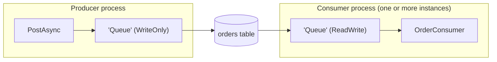

# Endpoints and configuration

[← User guide](user-guide.md)

An **endpoint** is a named connection to a transport. You post to endpoints by name, and the broker listens on every endpoint that can receive. One broker can use any mix of endpoints.

## Choosing an endpoint

| Endpoint | Package | Durable | Receives by | Failed messages | Batch send | Best for |
|---|---|---|---|---|---|---|
| **Memory** | `NymBroker` | no (process memory) | in-process channel | broker dead-letter endpoint | one by one | tests, in-process decoupling |
| **File** | `NymBroker` | yes (files) | file watcher + periodic scan | broker dead-letter endpoint | one by one | file drops, simple integration |
| **SQLite** | `NymBroker.Endpoint.Sqlite` | yes | polling a table | retried, then `Failed` row | one transaction | single-process apps, edge devices |
| **PostgreSQL** | `NymBroker.Endpoint.Postgres` | yes | polling + `LISTEN/NOTIFY` | retried, then `Failed` row | one statement | multi-instance apps already on Postgres |
| **SQL Server** | `NymBroker.Endpoint.SqlServer` | yes | polling a table | retried, then `Failed` row | one statement | multi-instance apps already on SQL Server |
| **MySQL** | `NymBroker.Endpoint.MySql` | yes | polling a table | retried, then `Failed` row | one statement | multi-instance apps already on MySQL 8.0+ / MariaDB 10.6+ |
| **RabbitMQ** | `NymBroker.Endpoint.RabbitMq` | yes | push (consumer) | requeued, then the queue's dead-letter exchange | one by one | a message broker you already run |
| **Azure Service Bus** | `NymBroker.Endpoint.AzureServiceBus` | yes | push (processor) | abandoned, then the queue's dead-letter queue | Service Bus batches | Azure, managed queues and topics |
| **HTTP** | `NymBroker.Endpoint.Http` | — (send only) | — (receive in your web app, see below) | the source retries; see [HTTP notes](#http-notes) | one request per message | REST APIs and webhooks of other systems |
| **Amazon SQS** | `NymBroker.Endpoint.AwsSqs` | yes | long polling | retried, then the queue's redrive dead-letter queue; messages that can never succeed go to the broker dead-letter endpoint | batches of 10 (not atomic) | AWS, managed queues (standard and FIFO) |

"Failed messages" is explained in [Reliability](reliability.md). PostgreSQL, SQL Server and MySQL let several application instances poll the same table safely; SQLite is meant for a single machine.

For the full durability, multi-node, dead-letter and crash/restart comparison, see [Delivery guarantees](delivery-guarantees.md).

## Registering endpoints in code

Every endpoint has an `Add…EndPoint(name, settings, mode)` method on the builder.

```csharp
services.AddNymBroker()
    // Core
    .AddMemoryEndPoint("Work", capacity: 1000)
    .AddFileEndPoint("Drop", new FileSettings { ReadPath = "in", PostPath = "out" })

    // NymBroker.Endpoint.Sqlite (namespace NymBroker.Endpoint.Sqlite)
    .AddSqliteEndPoint("Local", new SqliteSettings { ConnectionString = "Data Source=messages.db" })

    // NymBroker.Endpoint.Postgres
    .AddPostgresEndPoint("Pg", new PostgresSettings
    {
        ConnectionString = "Host=localhost;Database=app;Username=app;Password=…",
        TableName = "orders_queue"
    })

    // NymBroker.Endpoint.SqlServer
    .AddSqlServerEndPoint("Mssql", new SqlServerSettings
    {
        ConnectionString = "Server=…;Database=app;…",
        TableName = "dbo.orders_queue"
    })

    // NymBroker.Endpoint.MySql
    .AddMySqlEndPoint("My", new MySqlSettings
    {
        ConnectionString = "Server=…;Database=app;User ID=…;Password=…;SslMode=VerifyFull",
        TableName = "orders_queue"
    })

    // NymBroker.Endpoint.RabbitMq
    .AddRabbitMqEndPoint("Rabbit", new RabbitMqSettings
    {
        HostName = "localhost", ReadQueueName = "orders.in", WriteQueueName = "orders.in"
    })

    // NymBroker.Endpoint.AzureServiceBus
    .AddAzureServiceBusEndPoint("Bus", new AzureServiceBusSettings
    {
        ConnectionString = "<namespace connection string>",   // or FullyQualifiedNamespace + Credential
        QueueName = "orders"                                  // or TopicName (+ SubscriptionName to receive)
    })

    // NymBroker.Endpoint.Http (send only)
    .AddHttpEndPoint("PartnerHook", new HttpSettings
    {
        Url           = "https://partner.example.com/hooks/orders",
        SigningSecret = "<from a secret store>",   // adds an HMAC-SHA256 X-NymBroker-Signature header
        Headers       = { ["X-Api-Key"] = "<from a secret store>" }
    })

    // NymBroker.Endpoint.AwsSqs
    .AddAwsSqsEndPoint("Sqs", new AwsSqsSettings
    {
        QueueName = "orders",          // or QueueUrl; a name ending in .fifo is a FIFO queue
        Region    = "eu-north-1"       // credentials: the AWS SDK's default chain, or Credentials in code
    })
    .AddConsumer<OrderConsumer>()
    .Build();
```

Each endpoint's settings type defines its available options and defaults. The most important shared settings are:

| Setting | Endpoints | Meaning |
|---|---|---|
| `ConnectionString`, `TableName`, `AutoCreateTable` | SQLite, PostgreSQL, SQL Server, MySQL | where the queue table lives; it is created (and migrated) on first use when `AutoCreateTable` is true |
| `BatchSize`, `PollInterval` | SQL endpoints | rows claimed per poll; how long to wait after a poll that found nothing |
| `LeaseTimeout`, `MaxRetryCount` | SQL endpoints | how long a claimed row is locked; attempts before a row becomes `Failed` |
| `UseNotifications` | PostgreSQL | wake idle listeners with `NOTIFY` instead of waiting out `PollInterval` |
| `ReadQueueName`, `WriteQueueName` | RabbitMQ | queue to consume from / publish to |
| `UseTls`, `TlsServerName`, `ClientCertificatePath` | RabbitMQ | TLS with verified server certificate, optional client certificate — see [Production security](security.md#rabbitmq) |
| `MaxConcurrentCalls`, `PrefetchCount` | Azure Service Bus | parallel handlers (above 1 gives up ordering); messages fetched ahead |
| `ReadDeadLetterQueue` | Azure Service Bus | read the entity's dead-letter queue instead (repair / replay) |
| `WaitTimeSeconds`, `MaxNumberOfMessages`, `VisibilityTimeout` | Amazon SQS | long-poll wait (default 20 s); messages per receive (1–10); invisibility while a receive batch is handled (must cover the whole batch) |
| `RetryDelay`, `MessageGroupId` | Amazon SQS | how long a failed message stays invisible before redelivery (default 0); FIFO group (default: the envelope's correlation id) |
| `Url`, `Method`, `Headers`, `Timeout` | HTTP | where and how each message is sent; extra headers (never logged); timeout per attempt |
| `BodyFormat`, `SigningSecret` | HTTP | `Envelope` (default) or only the `Payload`; HMAC signature for the receiver to verify |
| `MaxRetryAttempts`, `RetryDelay`, `HealthCheckUrl` | HTTP | retries for transient failures (default 3, from 1 s, exponential); URL the health check GETs (unset: no probe) |
| `UseNativeDeadLetter` | RabbitMQ, Service Bus, SQL endpoints | let the transport retry and dead-letter (default `true`) — see [Reliability](reliability.md) |

The default connection settings, and the connection strings in the samples, match the local Docker containers — plaintext RabbitMQ, `TrustServerCertificate=True` for SQL Server, well-known passwords. For production, see [Production security](security.md).

Local Docker setups for PostgreSQL, SQL Server, MySQL, RabbitMQ, the Service Bus emulator and ElasticMQ (SQS-compatible) are in `scripts/` (`setup-postgres.ps1`, `setup-sqlserver.ps1`, `setup-mysql.ps1`, `setup-rabbitmq.ps1`, `setup-servicebus.ps1`, `setup-sqs.ps1`).

### Amazon SQS notes

- **Sample:** [NymBroker.AwsSqsSample](../samples/NymBroker.AwsSqsSample) shows a failed queue and a FIFO queue.
- **Failures.** SQS has no call to dead-letter a message on request. A failed message (`Retry`) becomes visible again after `RetryDelay`; give the queue a **redrive policy** (`maxReceiveCount` + a dead-letter queue), or it is retried until it succeeds or expires. Messages that can never succeed (undecodable, expired) and consumer failures go to the broker's `WithDeadLetterEndpoint`, so configure one.
- **Visibility.** Messages are deleted (one `DeleteMessageBatch`) when the whole receive batch has been handled. Set the queue's visibility timeout, or `VisibilityTimeout`, longer than handling `MaxNumberOfMessages` messages takes; otherwise a message can be delivered twice.
- **Bytes.** NymBroker envelopes are sent as text. Bytes posted with `PostRawAsync` that SQS cannot carry as text (not UTF-8, or control characters) are sent as Base64 with the message attribute `nymbroker-encoding` and decoded on receive.
- **FIFO queues** (`.fifo`): the message group is `MessageGroupId`, or else the envelope's `correlationId`; the deduplication id is the envelope's `id`, so posting the same envelope twice within SQS's deduplication window delivers it once.
- **Size.** Check the queue's maximum message size and post larger messages with `splitThresholdBytes`. `PostBatchAsync` sends up to 10 messages and 256 KB per request and is not atomic: a failed entry throws, and the messages before it stay sent.

### HTTP notes

The HTTP endpoint only **sends**: each message posted or routed to it becomes one request (`POST` by default).

- **Body and headers.** `BodyFormat = Envelope` (default) sends the NymBroker envelope as-is — right for another NymBroker instance. `Payload` sends only the envelope's `message`, for a third-party API with its own JSON. Bytes that are not an envelope (`PostRawAsync`) are sent unchanged. Every envelope also travels as headers: `X-NymBroker-Message-Id`, `-Message-Type`, `-Correlation-Id`, and `Idempotency-Key` = the message id, so the receiver can drop repeats.
- **Failures.** A 2xx response is success. Timeouts, network errors, 408, 429 and 5xx are retried `MaxRetryAttempts` times with exponential backoff (a `Retry-After` header is honoured, up to 60 s); then — and at once for any other status, such as 400 or 401 — `PostAsync` throws an `HttpRequestException` with the `StatusCode`. When the HTTP endpoint is a **route or topic destination**, that exception makes the broker return `Retry`, so the source queue redelivers the message and finally dead-letters it. A permanent failure like 400 is therefore retried until the source's retry limit (for example `MaxRetryCount` of a SQL queue) before it is dead-lettered.
- **Reliable sending (outbox).** Posting straight to the HTTP endpoint from a web request ties the request to the remote server. To survive outages, post to a durable queue and route it to the HTTP endpoint; a failed call is then retried by the queue:

  ```csharp
  .AddSqliteEndPoint("Outbox", new SqliteSettings { ConnectionString = "Data Source=outbox.db" })
  .AddHttpEndPoint("PartnerHook", new HttpSettings { Url = "https://partner.example.com/hooks/orders" })
  .AddRoute<OrderCreated>(r => r.To("PartnerHook").WhenFrom("Outbox"))
  …
  await broker.PostAsync("Outbox", order);   // durable at once; delivered (and retried) by the queue
  ```

- **HttpClient.** `AddHttpEndPoint` registers a named client (`"NymBroker.Http." + name`) with `IHttpClientFactory`. Its last parameter configures it, e.g. `client => client.AddHttpMessageHandler<MyAuthHandler>()` for OAuth tokens or a proxy.
- **Receiving webhooks** belongs in your ASP.NET Core app: verify the request (signature or API key), `await broker.PostRawAsync("Inbox", body)` to a **durable** queue, and return `202 Accepted`. Never run the consumer inside the request — the response would then depend on the consumer and its retries. Use an [input transformer](pipeline-extensions.md#input-transformers) for another system's JSON. [NymBroker.WebhookSample](../samples/NymBroker.WebhookSample) shows both directions, including signature verification with replay protection.

## Endpoint modes

Every `Add…EndPoint` takes an optional `EndpointMode`:

| Mode | Sends | Receives | Use for |
|---|---|---|---|
| `ReadWrite` (default) | ✓ | ✓ | most endpoints |
| `WriteOnly` | ✓ | — | producer processes that post and exit; dead-letter and audit endpoints; any destination you don't want processed again |
| `ReadOnly` | — | ✓ | inputs you must never post to |

```csharp
.AddSqliteEndPoint("Queue", settings, EndpointMode.WriteOnly)   // producer: no poll loop, exits promptly
```

`StartAsync` fails fast if a route, topic, dead-letter endpoint or wire tap targets a `ReadOnly` endpoint.



## Configuring endpoints from a file

Endpoints (and simple topics) can come from JSON, while consumers, subscribers and routes stay in code.

**`queuesettings.json`**

```json
{
  "NymBroker": {
    "Endpoints": [
      { "Name": "Work",  "Type": "Memory" },
      { "Name": "Drop",  "Type": "File", "Config": { "readPath": "in", "postPath": "out" } },
      { "Name": "Mssql", "Type": "SqlServer", "Config": { "connectionString": "…", "tableName": "dbo.orders_queue" } },
      { "Name": "Bus",   "Type": "AzureServiceBus", "Config": { "connectionString": "…", "queueName": "orders" } },
      { "Name": "Out",   "Type": "Memory", "Mode": "WriteOnly" }
    ],
    "Topics": [
      { "TopicName": "orders.events", "MessageType": "order.created", "SubscriberEndpoints": [ "Drop" ] }
    ]
  }
}
```

```csharp
services.AddNymBroker()
    .LoadConfiguration("queuesettings.json")   // also registers File and Memory entries
    .WithSqlServer()                           // each add-on registers its own entries
    .WithAzureServiceBus()
    .WithAwsSqs()
    .WithMySql()
    .WithHttp()
    .AddConsumer<OrderConsumer>()
    .Build();
```

- `Type` is matched case-insensitively. Built-in types: `Memory`, `File`, `Sql` (SQLite), `Postgres`, `RabbitMq`; add-ons define `SqlServer`, `MySql`, `AzureServiceBus`, `AwsSqs` and `Http`. An entry is only registered if the matching `With…()` is called — otherwise it is ignored, and posting to it fails with "No endpoint registered".
- `Config` holds the endpoint's settings in camelCase.
- `Mode` is a name, case-insensitive (`"ReadWrite"`, `"ReadOnly"`, `"WriteOnly"`), or a number (`0`, `1`, `2`). Omitted means `ReadWrite`. An unknown value makes the configuration fail to load with a `JsonException`.
- Secrets such as a Service Bus `TokenCredential` cannot come from the file; register those endpoints in code.
- To read from `appsettings.json` / `IConfiguration` instead of a file: `.ApplyConfiguration(BrokerConfigurationReader.Read(configuration))`.
