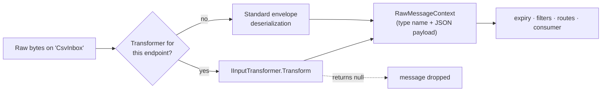

# Pipeline extensions

[← User guide](user-guide.md)

Four ways to plug your own logic into the broker: **filters** see every message before routing, **input transformers** turn non-JSON input into messages, **output transformers** turn messages into a destination's own format, and **scheduled actions** run code on a timer or cron schedule.

## Filters

A filter runs for every received message after deserialization and the expiry check, and before routes, topics and consumers. Return the context to continue, a modified context to change it, or `null` to drop the message (it is then completed — not retried, not dead-lettered).

```csharp
public sealed class BlockTestTraffic : IMessageFilter
{
    public IMessageContext? Filter(IMessageContext context)
        => context.Address?.From == "TestInbox" ? null : context;
}

services.AddNymBroker()
    .AddFilter(new BlockTestTraffic())   // an instance; filters run in the order they were added
    .AddFilter<TenantFilter>()           // or resolved from DI (registered as a singleton)
    .Build();
```

Built-in filters, added on the builder:

| Builder method | What it does |
|---|---|
| `AddIdempotentReceiver(ttl)` | drops messages whose `id` was already processed within `ttl` (in memory, per process; `AddSqlServerIdempotency` / `AddPostgresIdempotency` / `AddMySqlIdempotency` for a durable store shared by all instances; `AddSqliteIdempotency` for a restart-safe store on one host) — claimed before routing, completed or released (on `Retry`) after — see [Reliability](reliability.md#duplicate-detection) |
| `AddMessageLoggingFilter()` | logs every message (id, type, source, created, payload) at `Debug` level |

## Input transformers

Use an input transformer when an endpoint receives data that is **not** a NymBroker envelope — CSV lines, plain text, another system's JSON. It replaces the envelope deserialization for that endpoint (or for all endpoints):



```csharp
using NymBroker.Core.Serialize;   // RawMessageContext
using NymBroker.Core.Transform;   // IInputTransformer

public sealed class CsvOrderTransformer : IInputTransformer
{
    public RawMessageContext? Transform(ReadOnlySpan<byte> input, string? sourceEndpoint)
    {
        var parts = Encoding.UTF8.GetString(input).Trim().Split(',');
        if (parts.Length != 3) return null;   // drop lines that aren't orders

        return new RawMessageContext
        {
            Id            = Guid.NewGuid(),
            CorrelationId = Guid.NewGuid(),
            MessageType   = "order.created",          // must match a registered [MessageName]
            Created       = DateTime.UtcNow,
            RawMessage    = JsonSerializer.SerializeToElement(new
            {
                orderId  = parts[0],
                customer = parts[1],
                amount   = decimal.Parse(parts[2], CultureInfo.InvariantCulture)
            })
        };
    }
}

services.AddNymBroker()
    .AddFileEndPoint("CsvInbox", new FileSettings { ReadPath = "csv-in", SearchPattern = "*.csv" })
    .AddInputTransformer<CsvOrderTransformer>("CsvInbox")   // omit the name for a global fallback
    .AddConsumer<OrderConsumer>()
    .Build();
```

- The result goes through the rest of the pipeline exactly like a normal message: consumers receive the typed `OrderCreated`.
- Returning `null` drops the input without logging; log inside the transformer if you need a trace. A transformer that **throws** counts as a processing failure and is retried by transports that can.
- To push raw input yourself, post it with `PostRawAsync(endpoint, bytes)` — see [Sending messages](sending-messages.md#pre-serialized-bytes). The `samples/NymBroker.CsvSample` project shows the full flow.

## Output transformers

Use an output transformer when a destination expects its **own** format rather than the NymBroker envelope: XML for a legacy system, CSV, a partner's JSON schema. It is the counterpart of an input transformer. It is registered for one endpoint, and it converts every message sent to that endpoint just before the transport gets it:

```csharp
using NymBroker.Core.Serialize;   // RawMessageContext
using NymBroker.Core.Transform;   // IOutputTransformer

public sealed class OrderXmlTransformer : IOutputTransformer
{
    public byte[]? Transform(RawMessageContext message, string destinationEndpoint)
    {
        var order = message.RawMessage;   // the payload as a JsonElement; Id, CorrelationId, MessageType, Created alongside
        var xml = new XElement("Order",
            new XAttribute("id", order.GetProperty("orderId").GetString()!),
            new XElement("Amount", order.GetProperty("amount").GetDecimal()));
        return Encoding.UTF8.GetBytes(xml.ToString(SaveOptions.DisableFormatting));
    }
}

services.AddNymBroker()
    .AddMemoryEndPoint("CsvInbox")
    .AddFileEndPoint("LegacyOut", new FileSettings { PostPath = "legacy-out" }, EndpointMode.WriteOnly)
    .AddOutputTransformer<OrderXmlTransformer>("LegacyOut")
    .AddRoute<OrderCreated>(r => r.To("LegacyOut").WhenFrom("CsvInbox"))
    .Build();
```

- **Every send to the endpoint** goes through it: `PostAsync`, `PostBatchAsync`, route and topic deliveries, and the wire-tap or dead-letter endpoint if you point one at it. Other endpoints still get the envelope.
- Returning **`null`** sends nothing for that message. A transformer that **throws** fails the send like a failing endpoint: `PostAsync` throws, and a route makes the source retry (see [Reliability](reliability.md)).
- It needs an envelope. `PostRawAsync` with bytes that are not an envelope throws `InvalidOperationException`.
- **No splitting:** posting with `splitThresholdBytes` to the endpoint throws, because `SplitMessage` parts would not be in the destination's format.
- **Write-only:** `StartAsync` throws if the broker also listens on the endpoint (it is event-driven and not `WriteOnly`) and no input transformer can read the transformed format back. Make the endpoint `WriteOnly`, or add an input transformer for it.
- `StartAsync` also throws if the endpoint name is not registered.
- Transports don't learn the new format. The HTTP endpoint sends non-JSON bodies as `application/octet-stream` and, without an envelope, adds no `Idempotency-Key` / `X-NymBroker-*` headers. Service Bus still labels the message `application/json`, and the File endpoint still names its files `*.json`.
- `samples/NymBroker.CsvSample` reads CSV with an input transformer and writes the same orders as XML with an output transformer.

## Scheduled actions

Run code periodically while the broker is running — for example to post a heartbeat, poll an external system, or trigger a nightly job.

Scheduled actions are added on the builder. Each run gets its own DI scope (`services`) and the broker's stop token:

```csharp
services.AddNymBroker()
    // ...
    // Every minute (first run one minute after start).
    .AddScheduledAction(TimeSpan.FromMinutes(1), (services, ct) =>
        services.GetRequiredService<INymBroker>().PostAsync("Prices", new PriceRequest("ACME"), ct))

    // Cron (5-field syntax, local time zone): weekdays at 17:00.
    .AddScheduledAction("0 17 * * 1-5", async (services, ct) =>
        await services.GetRequiredService<ReportJob>().RunAsync(ct))   // scoped services work, e.g. a DbContext
    .Build();
```

#### Cron syntax

Five fields, `minute hour day-of-month month day-of-week`, separated by whitespace; seconds are always 0. Expressions are evaluated in the machine's local time zone. The parser is built in and is compatible with Cronos `CronFormat.Standard`, which was used before.

| Field | Values | Also allowed |
|---|---|---|
| minute | 0-59 | `*` `,` `-` `/` |
| hour | 0-23 | `*` `,` `-` `/` |
| day-of-month | 1-31 | `*` `?` `,` `-` `/` `L` `L-n` `nW` `LW` |
| month | 1-12 or `JAN`-`DEC` | `*` `,` `-` `/` |
| day-of-week | 0-7 (0 and 7 = Sunday) or `SUN`-`SAT` | `*` `?` `,` `-` `/` `nL` (last weekday n of the month) `n#k` (k-th weekday n) |

- Steps: `*/s`, `a-b/s` and `a/s` (from `a` to the field's maximum). Names are case-insensitive. Ranges must not be reversed (`5-1` is invalid).
- Macros: `@yearly`, `@annually`, `@monthly`, `@weekly`, `@daily`, `@midnight`, `@hourly`.
- When both day-of-month and day-of-week are restricted, a day must match both.
- An expression with no future occurrence (such as `0 0 30 2 *`) never fires.
- Daylight saving time: an occurrence in the spring-forward gap fires at the transition; in the fall-back overlap, fixed-time expressions fire once (first pass) and interval-style expressions (`*`, ranges or steps in the minute or hour field, e.g. `*/15 * * * *`) fire in both offsets.
- An invalid expression throws a `FormatException` when the action is added.

- Actions are asynchronous: `(IServiceProvider services, CancellationToken ct) => Task`. A run is awaited before the schedule waits for the next one, so runs of one action never overlap. Pass `ct` on; it is cancelled when the broker stops.
- Actions start with `StartAsync`, stop with `StopAsync`, and start again with a later `StartAsync`. They can't be added after the broker is built.
- An interval must be positive; it throws `ArgumentOutOfRangeException` otherwise.
- A run that throws is logged at `Error` and the schedule continues with the next occurrence. `StopAsync` never throws because of an action.
