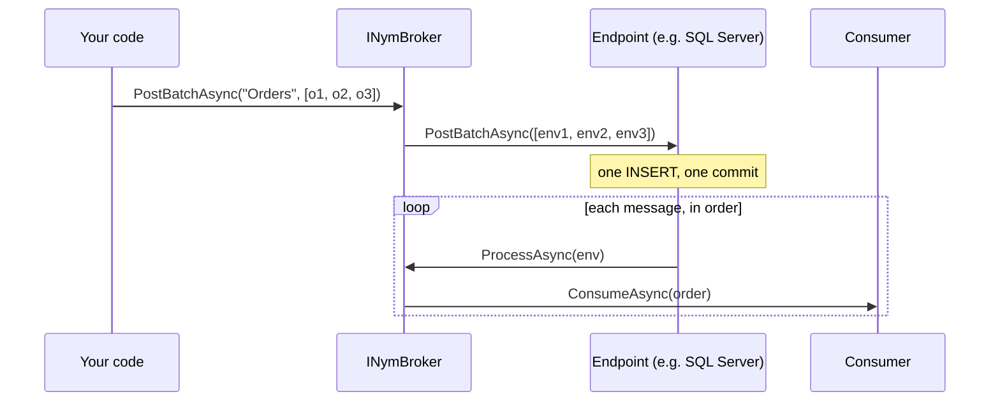
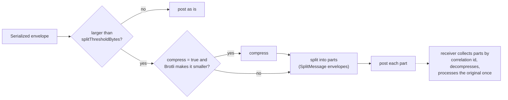

# Sending messages

[← User guide](user-guide.md)

There are two ways to send: **post** to a named endpoint, or **publish** without naming one. Both are on `INymBroker`, which you get from DI.

| Method | Sends to | Typical use |
|---|---|---|
| `PostAsync<T>(endpoint, message)` | one endpoint | commands, work items, anything with a known destination |
| `PostBatchAsync<T>(endpoint, messages)` | one endpoint, many messages in one call | bulk imports, fan-in of many items |
| `PostRawAsync(endpoint, bytes)` | one endpoint, pre-serialized bytes | raw input for an [input transformer](pipeline-extensions.md#input-transformers), envelopes you built yourself |
| `PublishAsync<T>(message)` | processed in-process: routes, topics, consumers | events raised inside the same application |
| `PublishAsync<T>(topicName, message)` | one named topic | events with known subscribers |
| `PublishBatchAsync<T>(...)` | as above, many messages | bulk events |

## Posting to an endpoint

```csharp
await broker.PostAsync("Orders", new OrderCreated("ORD-1", "Alice", 49.90m));
```

The message is serialized into an envelope and handed to the endpoint, which stores or transmits it. It is processed when the endpoint's listener receives it — immediately for an in-memory endpoint, on the next poll for a database queue.

`PostAsync` throws `InvalidOperationException` if no endpoint has that name or the endpoint is `ReadOnly`. Otherwise it returns once the transport has accepted the message (for the database endpoints: once the row is committed).

### Pre-serialized bytes

`PostRawAsync` posts bytes as they are — use it for input that an [input transformer](pipeline-extensions.md#input-transformers) turns into a message, or for envelopes you built yourself. It takes a `byte[]` / `ReadOnlyMemory<byte>`, or a `Stream`, which is read from its current position to the end (non-seekable streams such as a request body work too). The bytes are copied, so you can reuse your buffer afterwards. `splitThresholdBytes` and `compress` work as for `PostAsync`.

```csharp
await broker.PostRawAsync("CsvInbox", Encoding.UTF8.GetBytes("ORD-1,Alice,49.90,high"));
await broker.PostRawAsync("CsvInbox", httpContext.Request.Body, ct);
```

Passing bytes or a stream to `PostAsync`, `PostBatchAsync`, `PublishAsync` or `PublishBatchAsync` throws `ArgumentException`: those methods serialize their argument as a message, which for bytes would produce a payload no consumer understands. (Before 0.10.0 the stream variant was a `PostAsync` overload that needed a `(Stream)` cast to be picked.)

## Posting a batch

```csharp
await broker.PostBatchAsync("Orders", orders);                                  // IEnumerable<T>
await broker.PostBatchAsync("Orders", orders, correlationId: importId);          // same CorrelationId on all
```

Every message still gets **its own envelope** and is received, consumed and settled **one by one** — consumers, routes and dead-lettering don't change. Only the send is batched: the endpoint gets the whole list in one call and can send it in one round trip or transaction.



| Endpoint | How the batch is sent | All or nothing? |
|---|---|---|
| SQL Server, PostgreSQL, MySQL, SQLite | one insert in one transaction | yes |
| Azure Service Bus | as few Service Bus batches as fit (256 KB each on Standard) | per Service Bus batch |
| RabbitMQ | all published together, then all confirms awaited | no |
| Amazon SQS | requests of up to 10 messages and 256 KB | no |
| File, Memory | one message at a time | no |

Batches of 100 raise throughput 10–20× on the SQL endpoints and RabbitMQ; see the [benchmark](benchmarks.md) to measure your own setup.

- Order is preserved. An empty batch does nothing; a `null` element throws `ArgumentException` before anything is sent.
- If a non-atomic batch fails partway, some messages may already be sent. Retrying is safe if receivers use the [idempotent receiver](reliability.md#duplicate-detection).
- Use `PostBatchAsync`, not `PostAsync`, for a list: `PostAsync("Orders", list)` compiles but posts the whole list as **one** message.

## Deferring a message

Use `PostDeferredAsync` when a message must not be delivered before a given time, for example because a rate-limited service is free again in five minutes:

```csharp
public async Task ConsumeAsync(FetchPage job, IMessageContext context, CancellationToken ct = default)
{
    if (limiter.NextFreeSlot(job.Site) is { } freeAt)
    {
        await broker.PostDeferredAsync("Fetch", job, freeAt, ct);   // the listener moves on to the next message
        return;
    }
    await FetchAsync(job, ct);
}
```

- **Timing.** The message is delivered at or after `deliverAt`; a time in the past means now. It can come somewhat later: on the SQL endpoints a listener checks for due messages about four times a second (and at least once per `PollInterval`), and the message then joins the back of any backlog. Other messages on the endpoint are not held up, and the order of deferred messages relative to others is not kept.
- **Retries.** The first delivery is the first attempt, so the wait uses up no retries. Posting a new message as above gives it a new id and a fresh retry count. If the process crashes between the post and the acknowledgement, the job runs twice, as with any at-least-once delivery.
- **Message age.** The envelope's `created` is set to `deliverAt` if that is later than now, so `DiscardMessagesOlderThan`, age routes and the `nymbroker.message.age` metric count from the time the message becomes due. `PostRawDeferredAsync` leaves the bytes unchanged, so an envelope posted that way keeps its `created`.
- **Replay.** A dead letter you post again with `PostRawAsync` is delivered at once.
- **Size.** Deferred messages cannot be split. On a transport with a size limit, keep them under it.
- **Endpoints that cannot defer.** On RabbitMQ, HTTP, any custom endpoint without `IDeferredEndPoint`, SQS FIFO queues and SQS deferrals over 15 minutes, the broker holds the message in memory and sends it when it is due; a time in the past sends it at once. **The message is not durable:** it is lost if the process stops or crashes first. A consumer that re-defers its message and returns has settled the original, so nothing redelivers it. Use an endpoint with durable deferral if that matters. A warning is logged for each such endpoint when it is added, also if you never post a deferred message to it, except a read-only one. On SQS, that includes every standard queue, because of deferrals over 15 minutes.
  - On a graceful stop, messages still waiting are dropped, each with a logged warning. While the broker is stopped, a post that would have to wait throws `InvalidOperationException`, so a consumer deferring during shutdown fails and its message is redelivered.
  - A failed send when the message is due is logged and retried for about 5 minutes. After that the message is lost, with a logged error.
  - Each waiting message stays in this process's memory, with no limit on how many.

| Endpoint | How it waits | Limits |
|---|---|---|
| SQLite, PostgreSQL, SQL Server, MySQL | In a table of its own, `<table>_deferred`; a polling listener moves due messages to the queue | Durable. Needs a listener on the table. PostgreSQL, SQL Server and MySQL compare the time with the database's clock, SQLite with the listener's. With `AutoCreateTable = false`, create the table yourself: see [Deferred messages table](endpoints-and-configuration.md#deferred-messages-table) |
| Azure Service Bus | `ScheduledEnqueueTime` | Durable |
| Amazon SQS | `DelaySeconds`, rounded up to a whole second | Durable for up to 15 minutes. Longer deferrals, and all on FIFO queues (no per-message delay), wait in the broker's memory and are not durable: see above |
| File | The time is in the file name (`deferred-<UTC time>_<guid>.json`); a `FileEndPoint` reading the folder leaves the file until then | Durable. Another program reading the folder has to do the same |
| Memory | In memory, not counted against `capacity` | Not durable: dropped with a warning when the endpoint stops |
| RabbitMQ, HTTP, custom endpoints without `IDeferredEndPoint` | In the broker's memory | Not durable: see above |

## Large messages: split and compress

Some transports limit message size (Azure Service Bus Standard: 256 KB; UDP: ~64 KB). Pass `splitThresholdBytes` and the broker splits larger messages into parts and reassembles them on the receiving side:

```csharp
await broker.PostAsync("Orders", bigOrder, splitThresholdBytes: 200_000);
await broker.PostBatchAsync("Orders", orders, splitThresholdBytes: 200_000);   // per message
```



- Compression is on by default (`compress: true`) and only used when it actually shrinks the payload, so already-compressed or binary data isn't compressed twice.
- Only the part that completes the message triggers processing; consumers see the original message once.
- **Reassembly happens in memory in the receiving broker.** All parts of one message must reach the same broker instance; incomplete messages are discarded after 2 hours, with a logged warning. If processing a reassembled message ends in Retry, the broker keeps it in memory, also for up to 2 hours, so the redelivered last part brings it back without the other parts. A crash or restart in that time loses it, as it loses parts already received. If several instances compete for the same queue, avoid splitting (or keep messages under the transport's limit).

## Publishing

Publishing doesn't name an endpoint; the broker decides where the message goes.

```csharp
// By type: the message goes through the full in-process pipeline —
// routes, topics for OrderCreated, or the OrderCreated consumer.
await broker.PublishAsync(new OrderCreated("ORD-1", "Alice", 49.90m));

// To a named topic: delivered to that topic's subscriber endpoints and ISubscribe<T> subscribers only.
await broker.PublishAsync("orders.events", new OrderCreated("ORD-1", "Alice", 49.90m));
```

- A type-based publish runs **in your process, right now** — there is no queue in between. If a consumer throws, the message goes to the broker's dead-letter endpoint (if configured); if a route's destination can't be reached, `PublishAsync` throws.
- A named publish to an unknown topic throws `InvalidOperationException`, like a post to an unknown endpoint.
- `PublishBatchAsync(messages)` publishes each message in turn by type. `PublishBatchAsync(topicName, messages)` sends one batch to each of the topic's subscriber endpoints, and calls `ISubscribe<T>` subscribers one message at a time.

Topics are set up when you configure the broker — see [Routing and publish/subscribe](routing-and-pubsub.md#topics-and-subscribers).
